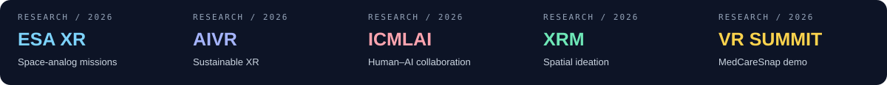
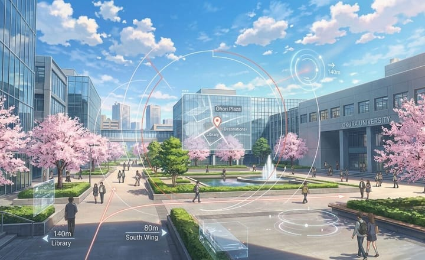
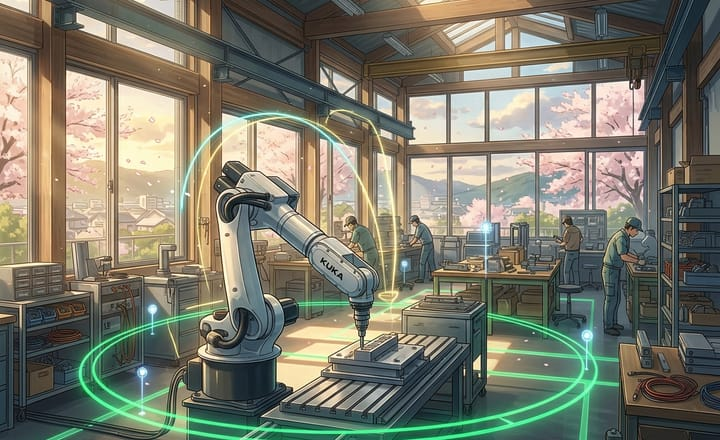
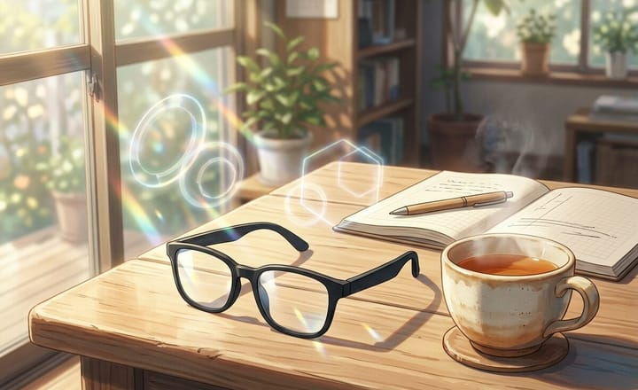

### XR & AI Researcher · Spatial Computing Engineer

Building smart-glasses experiences that connect intelligent systems with the physical world.

**[Portfolio](https://ashish11828.github.io/)** · **[Download CV](https://ashish11828.github.io/Ashish-Kumar-CV.pdf)** · **[LinkedIn](https://www.linkedin.com/in/ashish-kumar-76603216b)** · **[Contact](mailto:ak6358404@gmail.com)**

[Research](#research) · [Selected projects](#selected-projects) · [Experience](#experience) · [Toolkit](#toolkit)

---

## About

I'm **Ashish Kumar**, an independent XR and AI researcher and software engineer working across **spatial computing, human–computer interaction, machine learning, and computer vision**. I turn research questions into practical prototypes, from mixed-reality data collection for space-analog missions to hands-free industrial guidance and accessible smart-glasses interfaces.

My research contributions span **ESA XR, AIVR, ICMLAI, and XRM**, alongside a **VR Summit** demonstration. As a **Meta XROS Fellow**, I co-developed a HoloLens 2 maintenance prototype under NIFT-Delhi mentorship. My interdisciplinary background combines an **MSc in Digital Humanities from IIT Jodhpur** with a **BSc in Bioinformatics from GITAM University**.

## Research

**Spatial interfaces · Sustainable XR · Human–AI collaboration**

| Venue | Contribution | Status |
| :--- | :--- | :--- |
| **ESA XR 2026** · Germany | Mixed-reality camera interface for data collection in space-analog missions | Published · [Conference](https://www.esa.int/ESA_Multimedia/Videos/2026/05/ESA_XR_Conference_2026) |
| **AIVR 2026** · Japan | Sustainable system design for multimodal XR, AI, and IoT | Full paper accepted; oral presentation with major revisions · [Venue](https://www.aivr.org/AIVR2026.html) |
| **ICMLAI 2026** · Spain | Neural-sensing smart glasses for human–AI collaboration | Poster abstract accepted · [Venue](https://ai.pagesconferences.org/) |
| **XRM 2026** · Estonia | Mixed-reality mind mapping and content generation | Extended abstract accepted · [Venue](https://www.xrm2026.com/) |
| **VR Summit 2026** · Germany | MedCareSnap: spatial AR cardiac-response demonstration | Demo accepted · [Programme](https://vrs.ruhr-uni-bochum.de/programme-2026/) |

<strong>Full research titles</strong>

- **ESA XR:** Mixed-Reality Camera Interface for Enhanced Data Collection in Space Analog Missions.
- **AIVR:** Decarbonizing the Metaverse: Sustainable System Design for Multi-Modal XR, AI, and IoT Responsive Environments.
- **ICMLAI:** Neural-Sensing Smart Glasses for Human–AI Collaboration and Augmented Intelligence.
- **XRM:** Augmenting Ideation: A Mixed Reality Framework for Dynamic Mind Mapping and Content Generation.
- **VR Summit:** MedCareSnap — Live Spatial AR Cardiac Response Demonstration.

## Selected projects

**From spatial guidance to robot teaching and accessible wearables.**

<table>
<tr>
<td width="33%" valign="top">

<h3>MedCareSnap / Pulse</h3>

Hands-free CPR guidance and voice-controlled AED discovery for Snap Spectacles.

<strong>My contribution:</strong> Prototyped spatial guidance and AED discovery with Lens Studio, Python, WebSockets, and VoiceML.

XRCC 2026 finalist · VR Summit demo

<strong><a href="https://github.com/Ashish11828/xrcc_hack_2026">Source</a> · <a href="https://vrs.ruhr-uni-bochum.de/programme-2026/">Programme</a></strong>

</td>
<td width="33%" valign="top">

<h3>RoboXR AI</h3>

Robot teaching and spatial workflows for XREAL and Android XR.

<strong>My contribution:</strong> Engineered Kotlin and Compose architecture with AI planning, an offline fallback, spatial anchors, and operator audit trails.

Startup Buildathon India 2026 · Kochi

<strong><a href="https://github.com/Ashish11828/roboxreal">Source</a> · <a href="https://ai.studio/apps/f4d21451-b7b0-45d3-a92d-677d55155ca3">Demo</a></strong>

</td>
<td width="33%" valign="top">

<h3>FraudLens</h3>

Accessible scam-risk guidance designed for Meta Ray-Ban Display.

<strong>My contribution:</strong> Co-developed with Manav Rajpurohit; built read-aloud speech, adjustable text, high contrast, and reduced-motion modes.

Team Invisible Creator · Rules-based guidance

<strong><a href="https://github.com/Ashish11828/fraudlens">Source</a> · <a href="https://scamfruadlens.netlify.app/">Live app</a></strong>

</td>
</tr>
</table>

Project images are concept illustrations. Source repositories and linked demos show the implementations.

**More work:** [HoloLens 2 industrial maintenance](https://github.com/Ashish11828/xros-nift-project) · [ML from scratch](https://github.com/Ashish11828/deep-ml) · [AI safety evaluation](https://github.com/Ashish11828/Protect-safety-ai) · [All repositories](https://github.com/Ashish11828?tab=repositories)

## Experience

| Role | Organization | Focus |
| :--- | :--- | :--- |
| **Independent XR & AI Researcher** · Jul 2024–present | Independent | Spatial computing, human-centered AI, research, and interactive prototypes |
| **Software Development Intern** · Oct–Dec 2025 | Akiya 2.0 · Japan, remote | Automated data collection, cross-source integration, and database reliability |
| **Software Engineer** · Feb–Jun 2025 | TranquilMind.AI | Restorative VR environments and Meta Quest interaction in Unreal Engine and C++ |
| **XR Software Developer / Fellow** · Apr–Nov 2023 | Meta XROS Fellowship · FICCI | HoloLens 2 industrial maintenance prototype under NIFT mentorship |

**Education:** MSc Digital Humanities, **IIT Jodhpur** · BSc Bioinformatics, **GITAM University**.

## Toolkit

| Area | Tools & methods |
| :--- | :--- |
| **XR & spatial computing** | Unity · Unreal Engine · Lens Studio · HoloLens 2 · Meta Quest · Snap Spectacles · XREAL |
| **AI, ML & computer vision** | Python · PyTorch · TensorFlow · OpenCV · Scikit-learn · Model evaluation |
| **Mobile & connected systems** | Kotlin · Jetpack Compose · Flutter · Firebase · REST APIs · WebSockets |
| **Development & 3D** | C# · C++ · TypeScript · Git · Blender |

**Research interests:** Human–AI collaboration · Accessible HCI · Sustainable XR · AI safety · Quantum machine learning.

---

**Open to conversations about XR research, smart glasses, and human-centered AI.**

[Portfolio](https://ashish11828.github.io/) · [CV](https://ashish11828.github.io/Ashish-Kumar-CV.pdf) · [LinkedIn](https://www.linkedin.com/in/ashish-kumar-76603216b) · [Email](mailto:ak6358404@gmail.com)

[CodeChef](https://www.codechef.com/users/ashish_q121) · [Deep-ML](https://www.deep-ml.com/profile/oaJG47vYJNPTBQ6SBtm8KH2v66a2) · [Writing](https://medium.com/@akumar49139)

